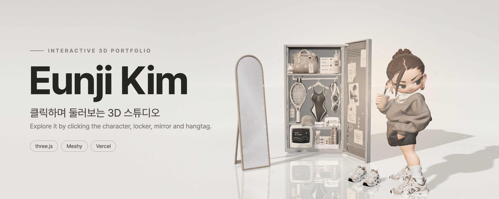

<p align="center">
  
</p>

<p align="center">
  <b>클릭하며 둘러보는 3D 스튜디오 포트폴리오</b><br>
  An interactive 3D portfolio you explore by clicking objects.
</p>

<p align="center">
  <a href="https://eunji-kim-portfolio.vercel.app"><b>Live site</b></a> ·
  <a href="#overview">Overview</a> ·
  <a href="#run-locally">Run locally</a> ·
  <a href="#built-with">Built with</a> ·
  <a href="#contact">Contact</a>
</p>

<a id="overview"></a>

## ✨ Overview · 소개

열린 락커와 캐릭터, 스탠드 거울이 있는 3D 스튜디오 장면입니다. 오브젝트를 누르면 카메라가 다가가고 해당 내용이 열립니다.
Click an object in the studio and the camera moves in to open its section.

| Object · 오브젝트 | Opens · 열리는 내용 |
| --- | --- |
| Character · 캐릭터 | **About** |
| Locker · 락커 | **Work** |
| Mirror · 거울 | **Now** |
| Hangtag on the locker door · 문에 걸린 행택 | **Contact** |

내용은 한국어와 영어를 나란히 보여줍니다. The page text is shown in Korean and English side by side.

<a id="features"></a>

## 🧩 Features · 특징

- **Studio look** · 반사되는 바닥, 돔 배경, 먼지 입자, 부드러운 그림자가 있는 스튜디오 룩
- **Click to explore** · 상단 메뉴, 화면의 표시점, 장면 속 오브젝트 어디서든 이동
- **Keyboard friendly** · `Esc`로 열린 패널을 닫고 장면으로 돌아오기
- **Single file** · HTML, CSS, JavaScript가 `index.html` 하나에 들어 있음

<a id="run-locally"></a>

## 🧭 Run locally · 로컬에서 실행

모델 파일을 불러와야 해서 `index.html`을 더블클릭하는 대신 간단한 로컬 서버가 필요합니다. 3D 라이브러리(three.js)를 CDN에서 받기 때문에 인터넷 연결도 필요합니다.
The 3D models load over HTTP, so serve the folder instead of opening the file directly. three.js comes from a CDN, so you also need a connection.

```bash
git clone https://github.com/keji2003-commits/eunji-kim-portfolio.git
cd eunji-kim-portfolio
python3 -m http.server 8000
```

그다음 브라우저에서 <http://localhost:8000> 을 엽니다.

<details>
<summary>Project structure · 폴더 구성</summary>

```text
index.html          the whole site: markup, styles, scripts, and the CONTENT object
assets/*.glb        four Meshy models: character, locker, mirror, sneakers
assets/cover/cover.jpg  README cover image
```

이름, About, Work, Now, Contact 문구는 `index.html`의 `CONTENT` 객체에서 바꿀 수 있습니다.
Name, About, Work, Now and Contact text live in the `CONTENT` object in `index.html`.

주소 뒤에 `?demo=1`을 붙이면 개인 정보를 자리표시 문구로 바꿔 보여주는 데모 모드가 켜집니다. 공개 영상을 만들 때 쓰는 모드입니다.
Add `?demo=1` to the address to swap personal details for placeholder text, a mode made for public videos.

</details>

<a id="built-with"></a>

## 🛠 Built with · 사용한 기술

| Tool · 도구 | Used for · 용도 |
| --- | --- |
| [three.js](https://threejs.org) r160 | 렌더링. `GLTFLoader`, `MeshoptDecoder`, `Reflector`, `RoomEnvironment`를 jsDelivr CDN에서 불러옴 |
| [Meshy](https://www.meshy.ai) | 캐릭터, 락커, 거울, 스니커즈 3D 모델 제작 |
| [Vercel](https://vercel.com) | 호스팅 |

<a id="contact"></a>

## 💌 Contact · 연락

- 🌐 Live site · <https://eunji-kim-portfolio.vercel.app>
- 📷 Instagram · [@habeebee0_0](https://www.instagram.com/habeebee0_0/)
- 💼 LinkedIn · [Eunji Kim](https://www.linkedin.com/in/eunji-kim-852953356/)
- 𝕏 X · [@habeebee_0](https://x.com/habeebee_0)

이메일은 사이트의 Contact에서 확인할 수 있습니다. Email is listed in the Contact section of the live site.

## 📄 License · 라이선스

아직 라이선스 파일이 없습니다. No license file has been added yet.

<p align="center">
  <a href="#overview">Overview</a> ·
  <a href="#run-locally">Run locally</a> ·
  <a href="#built-with">Built with</a> ·
  <a href="#contact">Contact</a> ·
  <a href="https://eunji-kim-portfolio.vercel.app">Live site</a>
</p>
